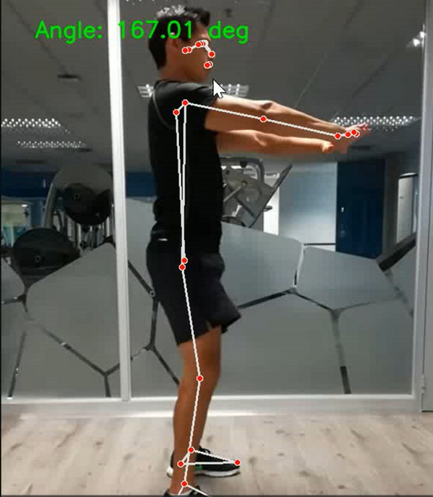
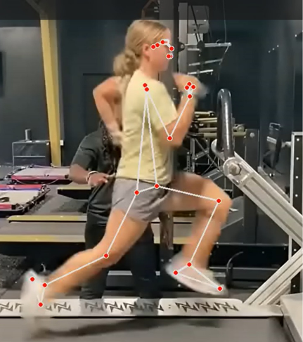
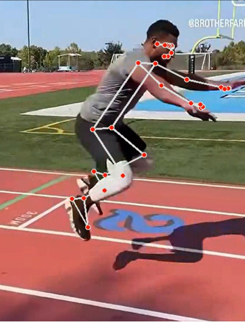
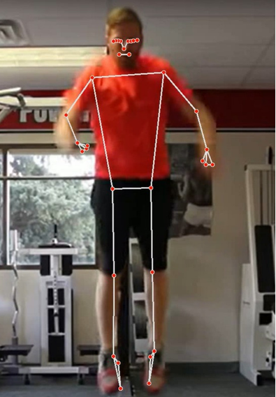

# Athletic Performance Analyzer

A Python computer-vision project that analyzes athlete movement in video using **MediaPipe Pose Landmarker (Tasks API)** and OpenCV. It estimates several movement metrics and can optionally save an athlete's results to **Firebase Cloud Firestore**.

## Features

- **Vertical jump:** estimates airtime and normalized jump height.
- **Sprint time:** measures the time taken for the hips to cross from 15% to 85% of the video frame.
- **Horizontal jump:** estimates horizontal displacement normalized to frame width.
- **Peak wrist velocity:** estimates maximum right-wrist speed in normalized frame units per second.
- **Knee and hip flexion:** calculates minimum left knee and hip angles in degrees.
- **Annotated videos:** saves a video with detected pose landmarks and relevant overlays.
- **Performance history:** optionally stores results in Firestore, organized by username.

## Screenshots

Examples of pose landmarks detected in sample videos:

<p align="center">
  
  
  
  
</p>

## How it works

1. OpenCV reads the input video frame by frame.
2. MediaPipe Pose Landmarker estimates 33 body landmarks for each frame.
3. The analysis functions calculate movement metrics from the normalized landmark coordinates and video frame rate.
4. Annotated videos are written to the `outputs/` directory.
5. If Firebase credentials are configured, results can be saved to Cloud Firestore.

## Requirements

- Python 3.13
- A webcam is not required; the application analyzes existing video files.
- Internet access is required once to download the MediaPipe pose model. Firebase also requires internet access.

## Installation

### 1. Clone the repository

```bash
git clone https://github.com/YOUR_USERNAME/Athletic-Performance-Analyzer.git
cd Athletic-Performance-Analyzer
```

### 2. Create and activate a virtual environment

Windows PowerShell:

```powershell
py -3.13 -m venv .venv
.\.venv\Scripts\Activate.ps1
```

macOS / Linux:

```bash
python3.13 -m venv .venv
source .venv/bin/activate
```

### 3. Install dependencies

```bash
python -m pip install --upgrade pip
python -m pip install -r requirements.txt
```

## Download the MediaPipe pose model

The application needs the Lite Pose Landmarker model. Download it once:

[Download pose_landmarker_lite.task](https://storage.googleapis.com/mediapipe-models/pose_landmarker/pose_landmarker_lite/float16/latest/pose_landmarker_lite.task)

Place the downloaded file in the project root, next to `athletic_performance_analyzer.py`.

Alternatively, set the `APA_POSE_MODEL` environment variable to the model's full path.

**The `.task` model is not included in this repository**; `.gitignore` excludes it.

## Firebase setup (optional)

Firebase is optional. Without credentials, the application can run in offline mode, but results cannot be saved or retrieved from Firestore.

1. Open Firebase Console and select your project.
2. Go to **Project settings → Service accounts**.
3. Generate a new private key.
4. Save the downloaded JSON file locally as `serviceAccountKey.json` in the project root.

The application reads the path from `FIREBASE_CREDENTIALS`. If the variable is not set, it looks for `serviceAccountKey.json` in the current working directory.

Windows PowerShell example:

```powershell
$env:FIREBASE_CREDENTIALS = "C:\path\to\serviceAccountKey.json"
```

macOS / Linux example:

```bash
export FIREBASE_CREDENTIALS="/path/to/serviceAccountKey.json"
```

**Never commit the Firebase service-account JSON file or expose its private key.** The credential file is excluded by `.gitignore`. Each person running the application should use their own Firebase credentials.

## Run the application

From the project root, with the virtual environment activated:

```bash
python athletic_performance_analyzer.py
```

Choose an option from the terminal menu. When prompted for a video, enter its path or drag the video file into the terminal. Leave the prompt blank to skip an analysis.

Processed videos are saved in `outputs/`.

## Run tests

The tests use synthetic landmark data and a fake Firestore client; they do not require the MediaPipe model or a live Firebase project.

```bash
python -m unittest discover -s tests -t . -v
```

## Project structure

```text
Athletic-Performance-Analyzer/
├── athletic_performance_analyzer.py
├── requirements.txt
├── README.md
├── .gitignore
├── docs/
│   └── images/
│       ├── pose-overlay-1.png
│       ├── pose-overlay-2.png
│       ├── pose-overlay-3.png
│       └── pose-overlay-4.png
└── tests/
    ├── __init__.py
    └── test_analyzer.py
```

Local-only files that should not be committed:

- `.venv/`
- `serviceAccountKey.json`
- `pose_landmarker_lite.task`
- `outputs/`

## Limitations

- Jump height and horizontal jump distance are normalized image measurements, not meters or centimeters.
- Sprint timing uses the 15% and 85% horizontal frame positions. It represents a 20 m sprint only when the filming setup maps that span to 20 m.
- Peak wrist velocity is expressed in normalized frame units per second, not meters per second.
- The current flexion analysis uses the left-side landmarks.
- The application analyzes the first detected person.
- Results depend on camera angle, framing, lighting, video quality, and landmark detection quality. They should be treated as estimates, not laboratory-grade measurements or medical assessments.
